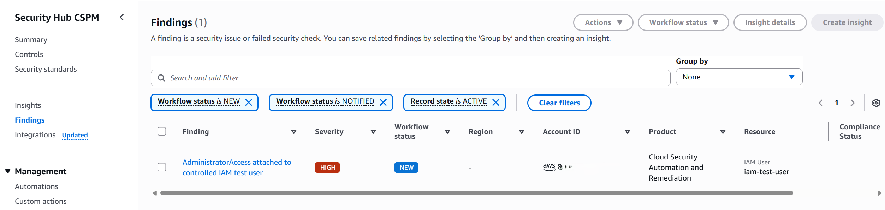
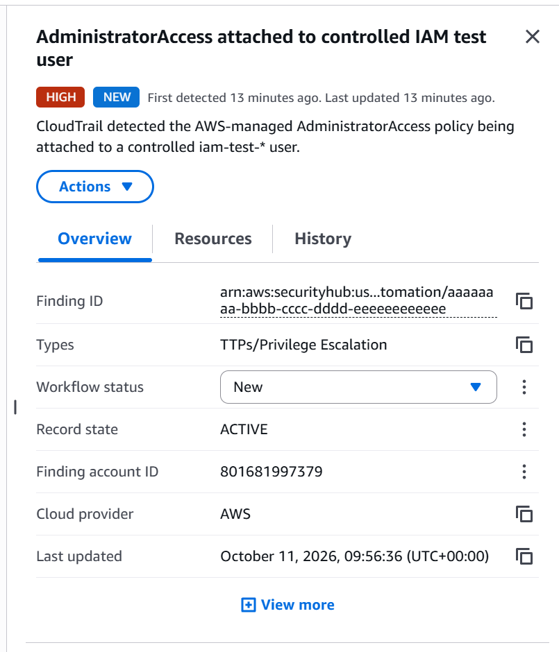
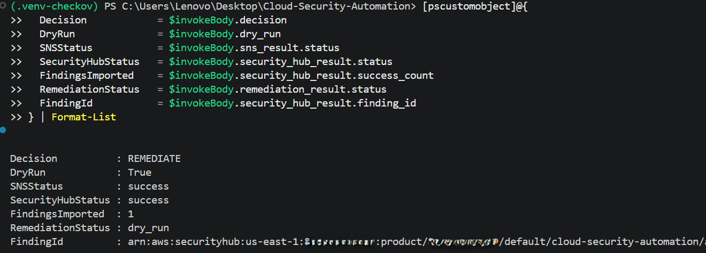
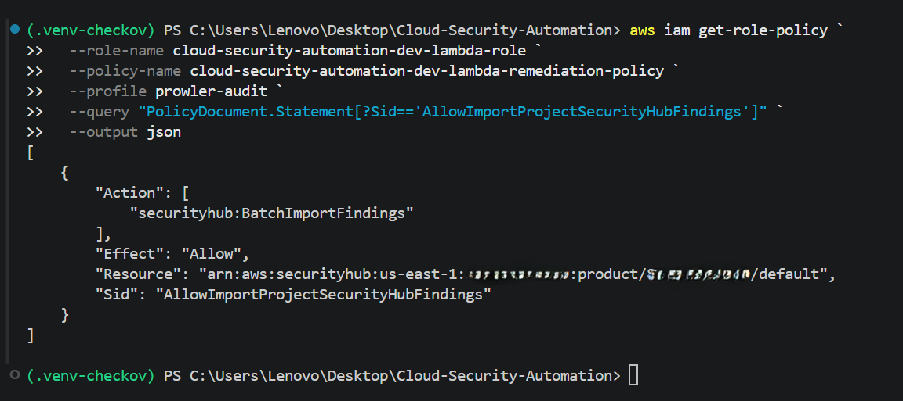

# Phase 5 - AWS Security Hub Integration

**Status:** Complete
**Validated:** 11 October 2026

## Objective

Convert the validated `AttachUserPolicy` plus `AdministratorAccess` detection into an AWS Security Finding Format (ASFF) finding in AWS Security Hub without weakening exception governance or changing remediation behaviour.

Phase 5 is reporting-only:

- `DRY_RUN=true` remains enabled.
- SNS remains the blocking notification control before any IAM action.
- Security Hub cannot trigger remediation.
- A Security Hub publication failure is visible but does not change the governance decision.
- Only the routed `IAM_ADMIN_POLICY_ATTACHMENT` control publishes findings.

## Implemented workflow

The Lambda workflow is:

1. **Decide** - validate event scope, policy risk and the DynamoDB exception record.
2. **Notify** - publish the existing SNS alert.
3. **Report** - import one ASFF finding for `REMEDIATE` or `SKIP_APPROVED`.
4. **Act** - retain the existing dry-run or controlled-remediation path.

Stable finding IDs use the CloudTrail `eventID`, with the EventBridge event ID as a fallback. Reprocessing the same event therefore targets the same Security Hub finding rather than creating a duplicate.

The finding contains the affected IAM user, control ID, API call, policy ARN, dry-run state and governance outcome. It intentionally excludes exception ticket IDs, approver identities and the full DynamoDB record.

## Security controls

### Feature flag and safe default

Terraform exposes `enable_security_hub`, which defaults to `false`. When enabled, Lambda receives:

```text
SECURITY_HUB_ENABLED=true
SECURITY_HUB_REGION=us-east-1
```

The deployment retained:

```text
DRY_RUN=true
```

This separates reporting enablement from remediation enablement.

### Least-privilege runtime permission

When `enable_security_hub=true`, Terraform grants the Lambda execution role only:

```text
securityhub:BatchImportFindings
```

The resource is restricted to the account's private default Security Hub product in `us-east-1`:

```text
arn:aws:securityhub:us-east-1:<account-id>:product/<account-id>/default
```

The role does not receive `securityhub:*`, `BatchUpdateFindings`, `GetFindings` or permission to enable Security Hub.

### Non-blocking reporting failure

Security Hub is a reporting destination, not the source of the remediation decision. SDK errors and rejected findings are returned through a structured `security_hub_result` and logged. They do not silently change `REMEDIATE` into `NO_ACTION`, approve an exception or enable IAM mutation.

## Deployment

Security Hub CSPM was deliberately enabled in `us-east-1` without enabling default security standards. This was sufficient for the custom ASFF finding test while avoiding unrelated standards findings and unnecessary lab cost.

The reviewed Terraform plan used the development variable file and an explicit feature flag:

```powershell
terraform -chdir="terraform/environments/dev" plan `
  -var-file="dev terraform.tfvars" `
  -var="enable_security_hub=true" `
  -out="phase5.tfplan"
```

Plan result:

```text
Plan: 0 to add, 2 to change, 0 to destroy.
```

The two in-place changes were:

- Update the Lambda environment and deployment package.
- Add `securityhub:BatchImportFindings` to the Lambda inline policy for the account-specific default product ARN.

The saved plan was applied successfully:

```powershell
terraform -chdir="terraform/environments/dev" apply "phase5.tfplan"
```

A post-deployment plan using the same inputs returned:

```text
No changes. Your infrastructure matches the configuration.
```

## Validation results

### Offline regression suite

```powershell
python -m unittest discover -s tests -v
```

Result:

```text
Ran 37 tests in 0.161s
OK
```

The Phase 5 tests cover successful ASFF import, stable finding IDs, the feature flag, SDK failure, partial import failure, no-action suppression and removal of sensitive exception metadata. Existing governance and remediation safety tests also remained green.

### Terraform validation

```powershell
terraform fmt -recursive -check
terraform -chdir="terraform/environments/dev" validate
git diff --check
```

Results:

- Terraform formatting check passed.
- Terraform configuration was valid.
- `git diff --check` found no whitespace errors.
- Windows reported informational LF-to-CRLF conversion warnings only.

### Checkov

```powershell
checkov -d terraform --framework terraform --compact
```

Result:

```text
Passed checks: 96
Failed checks: 18
Skipped checks: 0
```

No reported failure targeted the new Security Hub import grant. The Lambda remediation policy passed Checkov's full-IAM-privileges check (`CKV2_AWS_40`). The remaining findings belong to the existing infrastructure baseline and remain visible as documented technical debt; none was suppressed merely to produce a green scan.

### Live AWS integration test

The test used a controlled copy of `tests/fixtures/attach-self.json`. The temporary runtime copy replaced the sample account fields with the active AWS account ID while the committed fixture retained portable sample values.

Lambda was invoked directly in `us-east-1`. This validated the deployed Lambda-to-SNS and Lambda-to-Security-Hub integration without enabling live IAM remediation.

Observed result:

```text
Decision: REMEDIATE
DryRun: true
SNSStatus: success
SecurityHubStatus: success
FindingsImported: 1
RemediationStatus: dry_run
```

Security Hub displayed one custom finding with:

- Title: `AdministratorAccess attached to controlled IAM test user`
- Severity: `HIGH`
- Workflow status: `NEW`
- Record state: `ACTIVE`
- Type: `TTPs/Privilege Escalation`
- Resource: the controlled `iam-test-user`
- Product: `Cloud Security Automation and Remediation`

This Phase 5 validation used direct Lambda invocation rather than generating a new EventBridge event. The upstream CloudTrail and EventBridge path was validated in earlier phases.

### Duplicate-event validation

The same runtime fixture was invoked a second time with the same CloudTrail `eventID`. The second import succeeded, and a Security Hub query returned a count of:

```text
1
```

This proves the stable finding ID prevents duplicate Security Hub findings for the same event.

### Approved-exception path

The approved-exception reporting path was validated offline. Its unit test verifies an `INFORMATIONAL` `SKIP_APPROVED` finding and confirms that exception approver and ticket metadata are not exported. A separate live approved-exception Security Hub test was not performed during Phase 5.

## Evidence

### Security Hub finding list



Shows the custom finding in Security Hub with `HIGH` severity, `NEW` workflow status and the controlled IAM user resource.

### Security Hub finding details



Shows the finding description, privilege-escalation type, workflow status, record state and stable finding identifier.

### Successful Lambda publication



Shows `REMEDIATE`, successful SNS and Security Hub results, one imported finding, and `dry_run` remediation.

### Least-privilege IAM permission



Shows the deployed `securityhub:BatchImportFindings` permission restricted to the account-specific default product ARN.

Screenshots are sanitized before publication. Full account IDs, email addresses, exception approvers and ticket identifiers are not included in public evidence.

## Failure troubleshooting

If Security Hub returns `InvalidAccess`:

1. Confirm Security Hub is enabled in `us-east-1`.
2. Confirm the finding account ID matches the Lambda caller account.
3. Confirm the Lambda role has `BatchImportFindings` on the correct default product ARN.
4. Confirm `SECURITY_HUB_ENABLED=true` was deployed.
5. Inspect `FailedCount` and `FailedFindings` rather than treating an HTTP-successful batch request as proof that every finding was accepted.

## Known limitations

- Live IAM detachment remains disabled until Phase 6.
- Phase 5 directly invoked Lambda with a controlled fixture; it did not repeat the earlier CloudTrail-to-EventBridge validation.
- Only `IAM_ADMIN_POLICY_ATTACHMENT` currently publishes Security Hub findings.
- The approved-exception Security Hub path was validated with mocks, not against the live service.
- Repeated events reuse the Security Hub finding ID, but the current workflow can still send another SNS notification.
- Security Hub standards remain disabled for this focused custom-finding lab.
- The feature flag must be supplied consistently during future plans unless it is persisted in an appropriate environment-specific variable source.
- Automatic Security Hub workflow resolution and archival are outside Phase 5 scope.

## Definition of done

- [x] All 37 offline tests pass.
- [x] Terraform formatting and validation pass.
- [x] The reviewed plan contains only two intended in-place changes.
- [x] Terraform apply succeeds and the post-apply plan is drift-free.
- [x] Checkov results are recorded without hiding failures.
- [x] Security Hub is enabled only in the intended account and Region.
- [x] The deployed Lambda retains `DRY_RUN=true`.
- [x] The unapproved path imports a correctly classified live finding.
- [x] The approved path and sensitive-metadata exclusions pass offline tests.
- [x] Failed and partial import responses are covered by tests.
- [x] Replaying the same event does not create a duplicate Security Hub finding.
- [x] Sanitized evidence is stored under `diagrams/Phase-5/`.
- [x] README is updated with the Phase 5 result and evidence link.